<p align="center">
  
</p>

<p align="center">
  <a href="https://github.com/ArslanEren-Dev/truck-tms/releases/latest"></a>
  <a href="https://github.com/ArslanEren-Dev/truck-tms/actions/workflows/tests.yml"></a>
</p>

<p align="center">
  <a href="https://github.com/ArslanEren-Dev/truck-tms/releases/latest"></a>
  
  
  
  <a href="LICENSE"></a>
</p>

<p align="center">
  <b><a href="https://arslaneren-dev.github.io/truck-tms/">Website</a></b> ·
  <b><a href="https://github.com/ArslanEren-Dev/truck-tms/releases/latest">Download</a></b> ·
  <b><a href="CHANGELOG.md">What's new</a></b> ·
  <b><a href="#türkçe">Türkçe açıklama aşağıda</a></b>
</p>

**Truck TMS** is a free, open-source desktop app for small trucking fleets, dispatchers and owner-operators.
Trucks, drivers, loads, weekly statements and maintenance are all in one place, on your own computer: no account, no subscription, no cloud.
It is written in Python + Qt (PySide6), stores its data in a single SQLite file, and runs in English or Turkish with a white or black theme.


## Features

- **Trucks**: identify a truck by **plate, unit # or both**. Common US makes and models (Freightliner, Kenworth, Peterbilt,
  Volvo, Mack, International, Western Star…) are built in, and you can also type your own. Year, VIN, **odometer**, truck owner,
  default driver and company fee %. **Change a plate at any time**: loads stay linked to the truck and every change
  is kept in the **plate history**.
- **Drivers**: contact details, CDL # and expiry, and **pay settings**: % of gross, per mile/km, or a fixed weekly salary.
  The list shows each driver's **unpaid balance**.
- **Loads**: every detail is optional. **Load # always starts with `#`**. Each load can have a truck, a driver, broker,
  pickup and delivery, **rate**, **extra pay** (detention, layover, lumper), **loaded miles**, **dead miles**, and a **TONU** flag.
  The app calculates **total miles**, **gross per load** and **rate per mile**. The list shows which **statement week** each load
  belongs to.
- **Load board** *(new in 0.7)*: switch the Loads page between a list and a **board** with one column per status
  (Planned → Dispatched → In Transit → Delivered → Invoiced → Paid). Drag a card to the next column to update the load.
- **Details panel** *(new in 0.7)*: click a load and a panel slides in from the right with the route, dates, truck,
  driver, the profit breakdown with a margin gauge, and the invoice status. Edit or invoice it from there.
- **Today** *(new in 0.7)*: the Overview lists today's pickups and deliveries, late deliveries and delivered loads
  that still need an invoice, each one a click away. A new, empty file shows a three-step **getting started** guide.
- **Profit per load** *(new in 0.7)*: an estimated profit and profit per mile for every load, in green or red.
  It is the gross minus the dispatch fee, the driver's pay and fuel (the truck's fuel cost per mile).
- **Driver pay summary** *(new in 0.7)*: what each driver earned this month, last month, this quarter, this year or between
  any dates, with loads, miles, gross and pay per mile. Export it as PDF/CSV or print it.
- **Quick search and shortcuts** *(new in 0.7)*: **Ctrl+K** finds any load, truck, driver, invoice or page.
  Ctrl+N adds a record, Ctrl+F jumps to the search box, Ctrl+1…9 switch pages, and Enter / Delete edit or delete
  the selected row. **F1** lists every shortcut.
- **Weekly statements** (one per truck per week):
  - Loads are picked up automatically for the week (cancelled loads are skipped unless TONU).
  - Totals: **total weekly miles** (loaded + dead) and **total weekly gross**.
  - Costs: **fuel amount**, **fuel gallons**, **tolls**, and the **company / dispatcher fee** (% and/or fixed).
  - **Driver salary**: calculated from the driver's pay settings, or entered by hand. Add **driver additions and deductions**
    (bonus, advance…).
  - **Driver payment tracking**: the amount actually paid and the **payment date**. The app shows the remaining balance,
    because what the statement says is not always what gets paid.
  - **Owner additions and deductions** (insurance, trailer rental, ELD…) and the final **owner payout**.
  - **Export** an owner statement PDF, a driver statement PDF, a CSV, or all three. You can export this statement
    or every statement of the week, and **choose the folder and the file name**. The app remembers the folder.
- **Invoices and receivables** *(new in 0.6)*:
  - Select a load and click **Invoice**. The amount and the broker are filled in for you, and the invoice number counts
    up by itself (`INV-0001`…, prefix in Settings).
  - Payment terms (Net 30…), **quick pay** or **factoring** with its fee, partial payments, and the **balance due**.
    The load's status follows the invoice: *Invoiced*, then *Paid*.
  - The Invoices page shows what is **open**, what is **overdue**, what was **collected** in the last 30 days, the
    **average days to pay**, and an **aging** ring (not due yet · 1–30 · 31–60 · 61–90 · 90+ days late).
  - Save a clean **PDF invoice** with your company details, the load, line haul and accessorials.
- **Compliance reminders** *(new in 0.6)*: track what expires.
  - Driver items: **CDL**, **DOT medical card**, drug & alcohol test, MVR.
  - Truck items: **registration (IRP)**, **insurance**, **annual DOT inspection**, permits.
  - Company items: **UCR**, **Form 2290**, **MCS-150**, IFTA license.
  - Each item is shown as *Valid*, *Expires soon* (30 days) or *Expired*. Expired and expiring items show up on the Overview.
- **IFTA quarterly worksheet** *(new in 0.6)*:
  - Split a load's miles by state, and add gallons and the state to fuel expenses.
  - The IFTA page works out **fleet MPG**, **taxable gallons**, **tax-paid gallons**, **net gallons** and the
    **tax or credit** per state, for one truck or the whole fleet.
  - You enter the quarter's tax rates yourself, from the IFTA rate matrix.
  - Export it as PDF/CSV or print it.
  - It warns you about miles without a state split and about missing rates.
- **Update check** *(new in 0.6)*: once a day the app asks GitHub whether a new version is out.
  If there is one, an *Update available* button appears. You can also run the check from **Help → Check for updates**,
  or turn it off in Settings. The app only reads the public release page and sends no data.
- **Maintenance**: service records with odometer, cost, shop, details, and the next due date or odometer.
  Trucks that are due for service are highlighted.
- **Expenses** and a **Truck report** for any date range: gross, miles, expenses + maintenance, and net. Export it as PDF/CSV or print it.
- **Your data is always saved**:
  - Every change is written to the data file immediately. The status bar shows the file and the last save time.
  - **File** menu: *New data file*, *Open data file*, *Save* (Ctrl+S), *Save a backup copy*, *Open data folder*.
  - **Automatic daily backups** of the last 14 days are kept in a `backups` folder next to the data file.
  - The app reopens the file you used last.
- **Overview**: a gradient welcome band with your company name, the date and quick buttons, then eight key numbers
  that count up when the page opens: this week's gross and miles (with an 8-week trend line and the change against last
  week), loads on the road, active trucks, unpaid driver pay, receivables, trucks due for service and expiring documents.
  - **Charts**: weekly gross for the last 8 weeks, revenue per mile, top brokers, and expenses by category.
    The bars grow one after another and the line is a smooth curve. A highlight glides with the mouse and a bubble
    shows the value.
  - Today's work, recent loads, and reminders for service due, expired or expiring documents and late invoices.
- **Fast with big data**: with 6,000 loads, the Overview refreshes in about 20 ms and the window opens in under a second.
- **Import from Excel or CSV**:
  - Bring your existing loads in from a spreadsheet (`.xlsx` or `.csv`).
  - Columns are matched automatically from English or Turkish headers ("Load #", "PU Date", "DH", "Navlun"…).
    A preview lets you check the matching first.
  - US and Turkish number and date formats both work, as do Excel dates.
  - Trucks and drivers that do not exist yet are created for you, and loads that are already in the app are skipped.
  - A ready-made template is one click away.
- **Load documents**:
  - Drag rate confirmations, BOLs, PODs, invoices and receipts onto a load. The type is guessed from the file name.
  - A copy is kept in a `<data file>_documents` folder, so the originals can be moved or deleted.
  - Statement exports can include the loads' documents, and *Save a backup copy* copies them too.
- **Look and feel**:
  - A sidebar whose highlight slides to the page you pick, and pages that glide in.
  - A clean **white** or **black** theme with a one-click switch.
  - Colored status badges and a coloured status edge on every row; icon buttons that lift when you hover over them.
  - Cards that fade in one after another, numbers that glide to their new value, and a row that turns red before it
    is deleted.
  - Small notifications ("Saved", "Deleted", "Exported") that slide in at the bottom right, with a check mark that
    draws itself.
  - Friendly empty pages that tell you what to add first.
  - A start-up animation where a truck drives down the road from dusk into the night while the city lights come on.
- **English and Turkish** throughout, including dialogs, date pickers and PDFs. Automated tests check that every
  text exists in both languages.
- **Settings**: language, theme, company name and address for documents, currency, miles or km,
  the weekday statement weeks start on, and the default company fee %.

| Load board and details panel | Invoices & receivables |
|---|---|
| 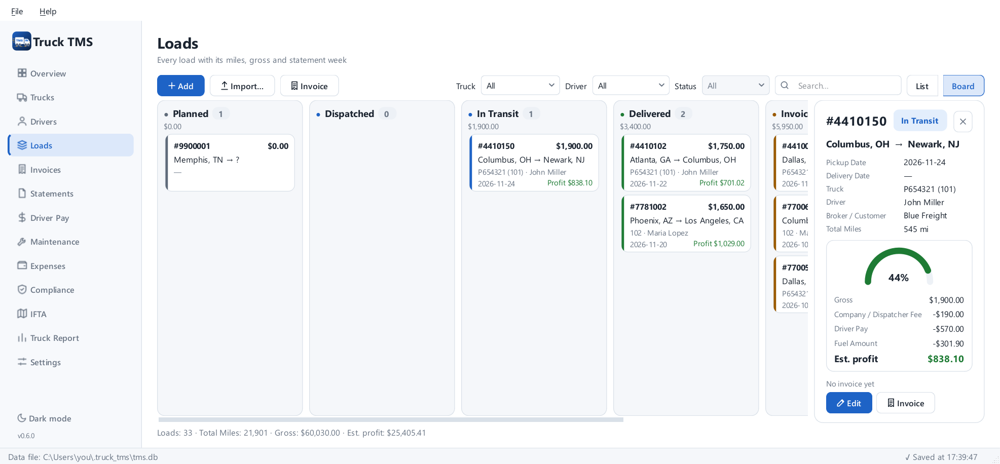 | 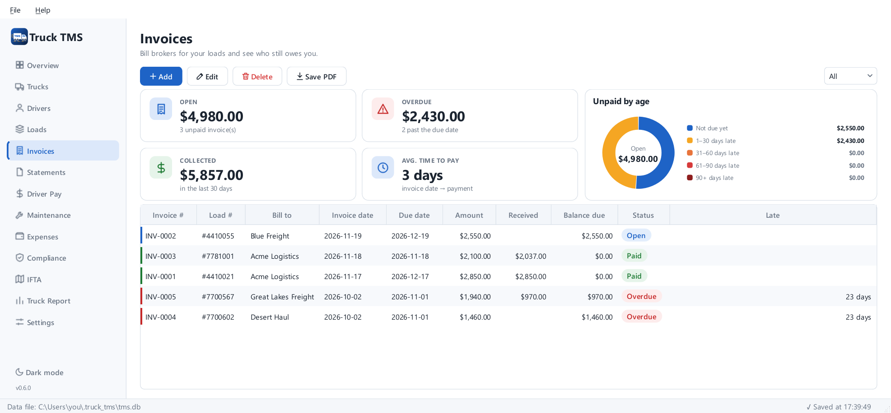 |
| **Compliance reminders** | **Driver pay and IFTA reports** |
| 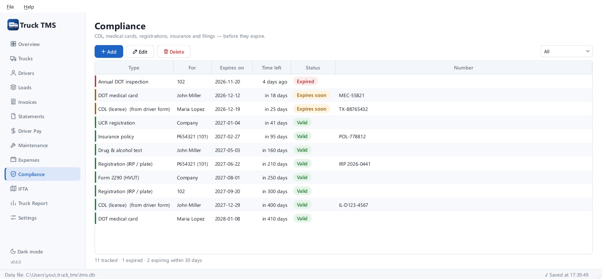 | 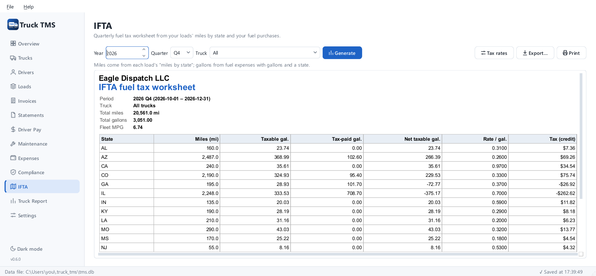 |
| **Invoice** | **Weekly statement** |
| 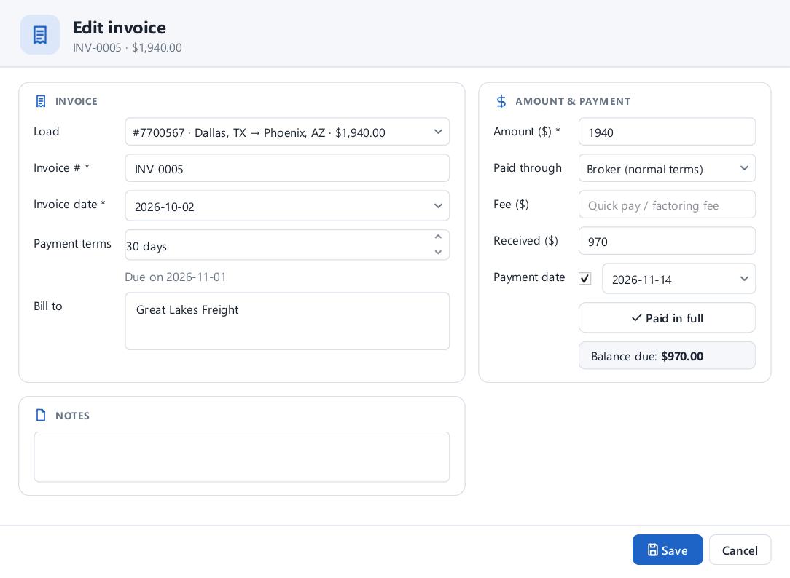 | 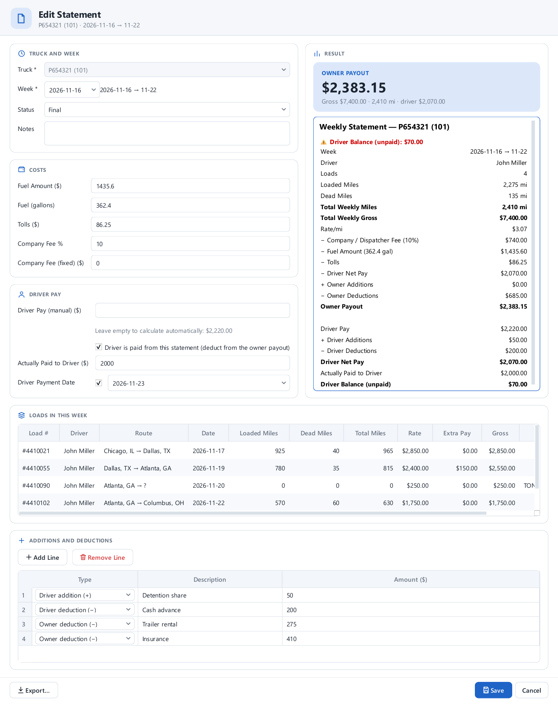 |
| **Trucks** | **Drivers** |
| 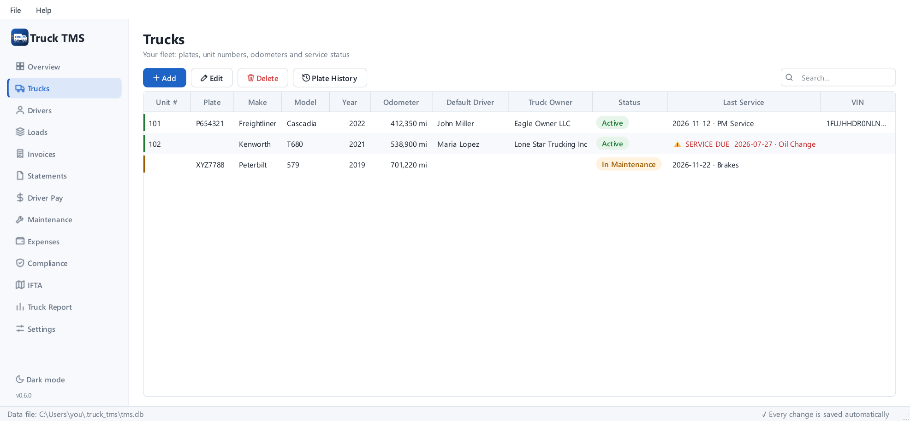 | 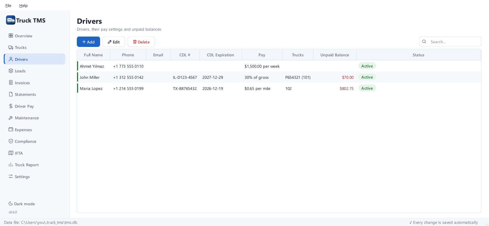 |
| **Loads** | **Statements** |
|  |  |
| **Maintenance** | **Export** |
| 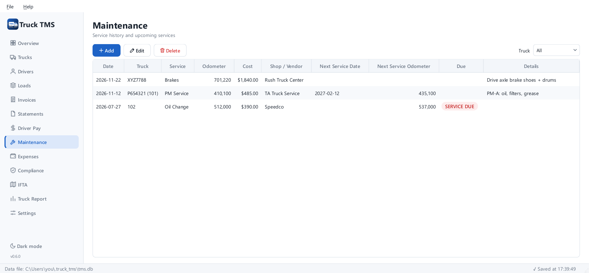 | 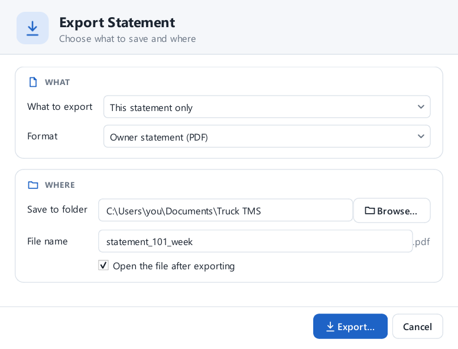 |
| **Import from Excel / CSV** | **Load documents** |
| 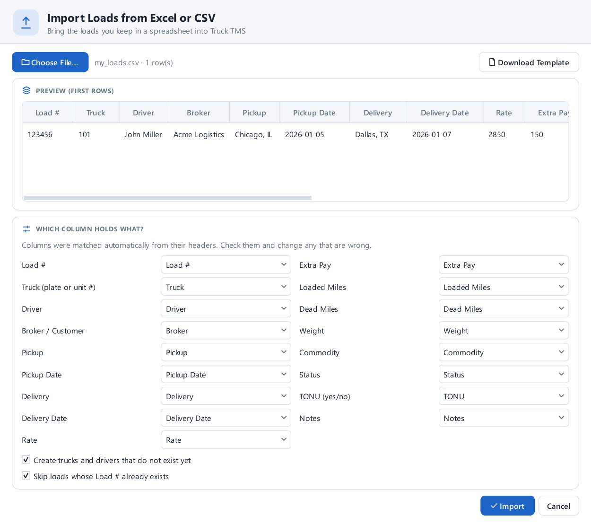 |  |
| **Dark theme · Türkçe** | **Start-up animation** |
|  |  |

### How the statement is calculated

```
Owner payout   = total weekly gross
               − company / dispatcher fee  (gross × % + fixed)
               − fuel − tolls
               − driver net pay            (only if "driver is paid out of this statement" is ticked)
               + owner additions − owner deductions

Driver net pay = driver salary (auto or manual) + driver additions − driver deductions
Driver balance = driver net pay − amount actually paid to the driver
```

A load belongs to the week of its delivery date (or its pickup date if there is no delivery date).
You can also choose the week by hand on the load.

## Download (Windows)

Every [release](https://github.com/ArslanEren-Dev/truck-tms/releases/latest) has two downloads. Neither needs Python.

| File | What it is |
|---|---|
| **`TruckTMS-Setup.exe`** | The installer *(from 0.7)*. Installs for your user without administrator rights, adds Start menu and desktop shortcuts, and can be removed from Windows settings. Removing it never deletes your data. |
| **`TruckTMS.exe`** | The portable app: one file, nothing to install. Put it anywhere and double-click it. |

Windows may show a SmartScreen warning because the files are not code-signed. Click **More info → Run anyway**.
On Windows 11 with **Smart App Control** turned on, the exe may be blocked. In that case, run the app from source (see below).
Our SignPath Foundation application for free code signing has not been approved yet, because the project does not have enough
downloads so far; we will reapply as it grows. See the [code signing policy](docs/CODE_SIGNING.md).

To build them yourself, run `powershell -ExecutionPolicy Bypass -File packaging\build_exe.ps1` (result: `dist\TruckTMS.exe`),
then `packaging\build_installer.ps1` with [Inno Setup 6](https://jrsoftware.org/isinfo.php) installed (result: `dist\TruckTMS-Setup.exe`).

To try the app with sample data in a separate file, run `TruckTMS.exe --db demo.db --demo`.

## Install & run from source

Requires Python 3.12+.

```bash
git clone https://github.com/ArslanEren-Dev/truck-tms.git
cd truck-tms
python -m venv .venv
# Windows: .venv\Scripts\activate    macOS/Linux: source .venv/bin/activate
pip install -e .
truck-tms            # or: python -m truck_tms
```

Try it with sample data in a separate database:

```bash
truck-tms --db demo.db --demo
```

By default data is stored in `~/.truck_tms/tms.db`. You can change this with `--db PATH` or the `TRUCK_TMS_DB` environment variable.
To back up your data, copy that file. Databases created by older versions are upgraded automatically.

## How it works

| System | What happens |
|---|---|
| **Data** | Everything is stored in one SQLite file on your computer (`~/.truck_tms/tms.db` by default, or any file you open). Each change is saved straight away. Older files are upgraded automatically when a new version opens them. |
| **Backups** | Once a day, a copy goes to `backups/` next to the data file, and the newest 14 are kept. *Save a backup copy* copies the attached documents too. |
| **Statements** | Gross − dispatcher fee − fuel − tolls − driver net pay (if the driver is paid from the statement) ± owner items = owner payout. See [How the statement is calculated](#how-the-statement-is-calculated). |
| **Invoices** | Balance due = amount − received − quick pay / factoring fee. The due date is the invoice date + terms. Each unpaid invoice falls into an aging bucket by days past due, and the load's status follows its invoice. |
| **Compliance** | An item is *Expired* after its date and *Expires soon* within 30 days. Both kinds show up on the Overview. |
| **IFTA** | Fleet MPG = miles ÷ gallons. Then for each state: taxable gallons = state miles ÷ MPG, net gallons = taxable − tax-paid gallons, and tax = net gallons × your rate. |
| **Updates** | At most once a day, the app reads the public *latest release* page of this repository and compares version numbers. Nothing about you or your data is sent. You can turn it off in Settings. |
| **Profit** | Estimated profit = gross − dispatch fee − driver pay − fuel, where fuel = the load's miles × the truck's fuel cost per mile (its fuel expenses ÷ its miles, or the fleet average). |
| **Quality** | Every push runs ruff and the 898 tests on Windows and Linux with Python 3.12 and 3.13. Each test has a 2-minute limit. When a release is published, GitHub builds the exe and the installer, self-tests both (including a silent install and uninstall) and attaches them with SHA-256 checksums. |

All changes, version by version: **[CHANGELOG.md](CHANGELOG.md)**.

## Development

```bash
pip install -e ".[dev]"
pytest
```

```
truck_tms/                 business logic: no GUI code, tested on its own
  database.py   SQLite schema (version 3), automatic upgrades, data classes, validation
  statement.py  weekly statement: owner payout, driver pay, HTML and CSV
  invoicing.py  invoices, receivables, aging buckets, printable invoice
  compliance.py expiring documents: expired / expires soon / valid
  ifta.py       IFTA quarter: fleet MPG, taxable / tax-paid / net gallons, tax per state
  report.py     truck report for any date range
  profit.py     estimated profit per load, driver pay rules and the driver pay summary
  today.py      today's pickups, deliveries, late loads and loads to invoice; getting-started steps
  search.py     Ctrl+K search across loads, trucks, drivers and invoices
  printout.py   shared pieces of every printout (money format, page, header, totals)
  importer.py   Excel/CSV import: .xlsx reader, column matching, row-by-row import
  updates.py    asks GitHub for the latest release (version compare, no personal data)
  numbers.py    US / Turkish numbers and dates, Excel serial dates
  weeks.py      statement-week helpers
  i18n.py       English / Turkish strings (add a language by adding a column)
  demo.py       sample data for every page
  ui/           PySide6: main window, pages, dialogs, charts, theme, animations
  assets/       app icon and theme images
tests/          898 pytest tests: logic, translations, backups, migrations and the GUI itself
docs/           website (index.html), logo, banner, screenshots, make_media.py
packaging/      build_exe.ps1 (PyInstaller exe), build_installer.ps1 + TruckTMS.iss (Inno Setup installer)
CHANGELOG.md    what changed in every version
```

- `ruff check .` runs the lint rules from `pyproject.toml`; CI runs it too.
- `python docs/make_media.py` regenerates every screenshot and the banner from the demo data.
- `TruckTMS.exe --self-test FOLDER` checks a packaged build: it opens every screen in both languages and themes,
  exports PDFs and CSVs, and writes `self_test.log`.

### Publishing a new version

The exe is built by GitHub, so you don't have to build it on your own computer:

1. Set the new version in `truck_tms/__init__.py` and `pyproject.toml` (e.g. `0.8.0`).
2. On GitHub, open **Releases → Draft a new release**, create the tag `v0.8.0`, and click **Publish release**.
3. The [release workflow](.github/workflows/release.yml) runs the tests, builds `TruckTMS.exe`, runs the exe's self-test,
   builds the installer, tests a silent install and uninstall, and attaches `TruckTMS.exe`, `TruckTMS-Setup.exe` and their
   SHA-256 checksums to the release. This takes about 6 minutes; you can watch it on the **Actions** tab.

The workflow stops if the tag does not match the version in the code. Use **Actions → release → Run workflow** to build an exe without
publishing a release.

### Project website (GitHub Pages)

`docs/index.html` is a bilingual (EN/TR) landing page with the same truck-on-the-road animation as the app.
To publish it, open **Settings → Pages**, choose **Deploy from a branch**, then pick **main** and the **/docs** folder.
It will be online at <https://arslaneren-dev.github.io/truck-tms/>.

To set the social preview, open **Settings → General → Social preview** and upload `docs/banner.png` (1280×640).

Ideas for contributions: fuel-card imports, a broker directory, more report types, and more languages. See the [contributing guide](.github/CONTRIBUTING.md);
issues and pull requests are welcome.

## License

[MIT](LICENSE) · [Third-party licenses](docs/THIRD_PARTY_LICENSES.md) · [Code signing policy](docs/CODE_SIGNING.md) ·
Made by [ArslanEren-Dev](https://github.com/ArslanEren-Dev)

Truck TMS adds no dependencies beyond Python and PySide6 (LGPL). It reads Excel files with the standard library
and draws its own charts, so the GPL-licensed Qt Charts module is not used.

---

## Türkçe

Küçük nakliye filoları, dispatch firmaları ve kendi tırıyla çalışanlar için ücretsiz, açık kaynaklı bir **TMS (Taşımacılık Yönetim Sistemi)**.
Tırlar, sürücüler, yükler, haftalık statement'lar ve bakım tek bir yerde, kendi bilgisayarınızda. Hesap, abonelik ya da bulut yok.
Python + Qt (PySide6) ile yazılmıştır. Veriler tek bir SQLite dosyasında tutulur. Arayüz Türkçe ve İngilizce, tema beyaz veya siyah olabilir.

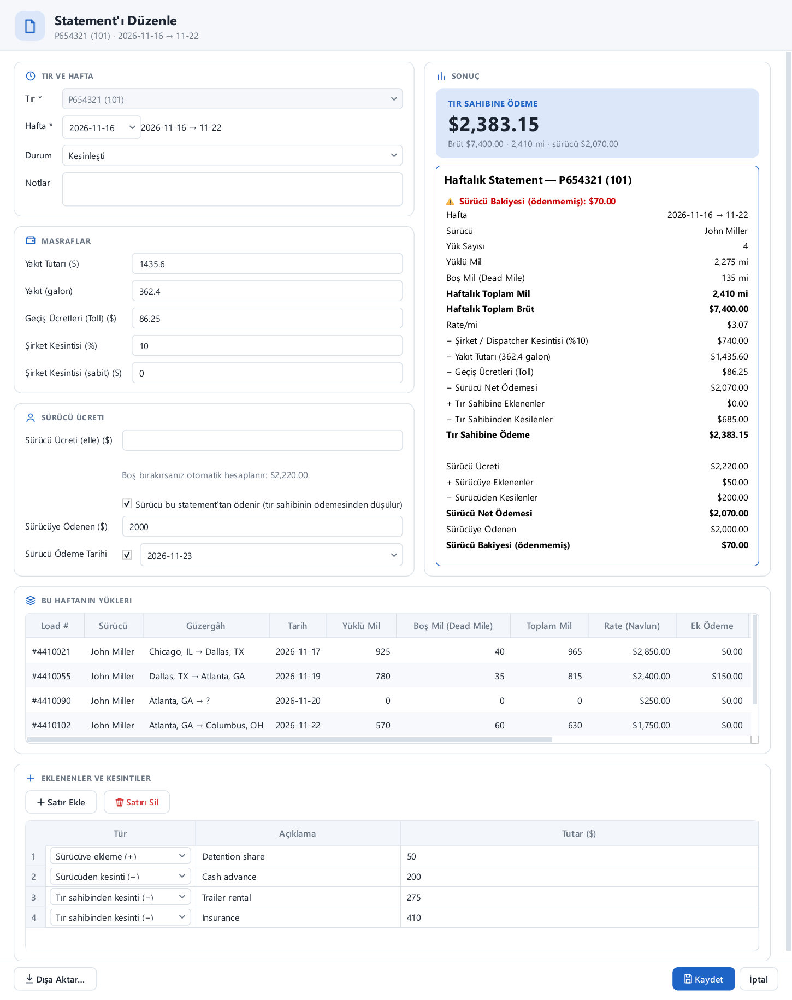

### Özellikler

- **Tırlar**: tırı **plaka, araç kodu veya ikisiyle birden** kaydedin. ABD markaları ve modelleri listede hazır gelir
  (Freightliner, Kenworth, Peterbilt, Volvo, Mack, International, Western Star…), isterseniz kendiniz de yazabilirsiniz.
  Yıl, VIN, **kilometre/mil sayacı**, tır sahibi, varsayılan sürücü ve şirket kesintisi % de girilebilir.
  Plaka istendiği zaman değiştirilebilir ve her değişiklik **plaka geçmişinde** saklanır.
- **Sürücüler**: iletişim bilgileri, CDL no ve bitiş tarihi, **ödeme şekli** (brütün %'si, mil/km başına veya sabit haftalık).
  Listede her sürücünün **ödenmemiş bakiyesi** görünür.
- **Yükler**: tüm detaylar isteğe bağlıdır. **Load # her zaman `#` ile başlar.** Bir yükte tır, **yükü süren sürücü**,
  broker, **rate**, **ek ücret** (detention, layover, lumper), **yüklü mil**, **boş mil (dead mile)** ve **TONU** bilgisi bulunabilir.
  **Toplam mil**, **yük başına brüt (gross)** ve **mil başına rate** otomatik hesaplanır. Listede her yükün
  **hangi statement haftasına dahil olduğu** görünür.
- **Yük panosu** *(0.7'de yeni)*: Yükler sayfası liste ile **pano** arasında geçiş yapar. Panoda her durum bir sütundur
  (Planlandı → Yola Çıkarıldı → Yolda → Teslim Edildi → Faturalandı → Ödendi). Kartı sürükleyip bırakınca yükün durumu değişir.
- **Detay paneli** *(0.7'de yeni)*: bir yüke tıklayınca sağdan bir panel kayarak açılır: rota, tarihler, tır, sürücü,
  kâr göstergesiyle kâr dökümü ve fatura durumu. Düzenleme ve faturalama oradan yapılabilir.
- **Bugün** *(0.7'de yeni)*: Genel Bakış'ta bugünkü yüklemeler ve teslimatlar, geciken teslimatlar ve faturalanmayı
  bekleyen yükler, her biri tek tıkla açılır. Yeni ve boş bir dosyada üç adımlık **başlangıç rehberi** çıkar.
- **Yük başına kâr** *(0.7'de yeni)*: her yük için tahmini kâr ve mil başına kâr, yeşil veya kırmızı renkte.
  Brütten dispatch ücreti, sürücü ödemesi ve yakıt (tırın mil başına yakıt maliyeti) düşülür.
- **Sürücü ödeme özeti** *(0.7'de yeni)*: her sürücünün bu ay, geçen ay, bu çeyrek, bu yıl veya istediğiniz tarihler
  arasındaki kazancı; yük, mil, brüt ve mil başına ödeme. PDF/CSV olarak dışa aktarın veya yazdırın.
- **Hızlı arama ve kısayollar** *(0.7'de yeni)*: **Ctrl+K** ile her yükü, tırı, sürücüyü, faturayı veya sayfayı bulun.
  Ctrl+N yeni kayıt, Ctrl+F arama kutusu, Ctrl+1…9 sayfa geçişi, Enter / Delete seçili satırı düzenler veya siler.
  **F1** tüm kısayolları gösterir.
- **Haftalık statement** (her tır için haftada bir tane):
  - O haftanın yükleri otomatik gelir.
  - Toplamlar: **haftalık toplam mil** ve **haftalık toplam brüt**.
  - Masraflar: **yakıt tutarı**, **yakıt (galon)**, **toll** ve **şirket/dispatcher kesintisi** (% ve/veya sabit).
  - **Sürücü maaşı**: sürücünün ödeme ayarlarından otomatik hesaplanır ya da elle girilir. **Sürücüye eklenenler ve
    sürücü kesintileri** (bonus, avans…) ayrı satırlarda yazılır.
  - **Sürücü ödeme takibi**: sürücüye **gerçekte ödenen tutar** ve **ödeme tarihi** girilir, kalan bakiye gösterilir.
    Statement'ta yazan her zaman ödenmeyebilir.
  - **Tır sahibi kesintileri ve eklemeleri** (sigorta, trailer kirası, ELD…) ve sonuçta **tır sahibine ödenecek tutar (owner payout)**.
  - **Dışa aktarma**: tır sahibi PDF'i, sürücü PDF'i, CSV veya üçü birden. Yalnızca bu statement ya da o haftanın
    bütün statement'ları seçilebilir. **Klasör ve dosya adı sizin seçiminizdir**; seçilen klasör hatırlanır.
- **Faturalar ve alacaklar** *(0.6'da yeni)*:
  - Bir yükü seçip **Fatura**'ya tıklayın. Tutar ve broker otomatik dolar, fatura numarası kendiliğinden artar
    (`INV-0001`…; ön ek Ayarlar'dan değiştirilir).
  - Ödeme vadesi (Net 30…), **quick pay** ya da kesintisiyle **factoring**, kısmi ödemeler ve **kalan borç** girilebilir.
    Yükün durumu faturayı izler: önce *Faturalandı*, sonra *Ödendi*.
  - Faturalar sayfasında **açık alacak**, **gecikmedeki tutar**, son 30 günün **tahsilatı**, **ortalama ödeme süresi**
    ve **yaşına göre alacaklar** halkası görünür (vadesi gelmedi · 1–30 · 31–60 · 61–90 · 90+ gün gecikme).
  - Şirket bilgileriniz, yük detayları ve ücret kalemleriyle düzenli bir **PDF fatura** kaydedin.
- **Belge takibi** *(0.6'da yeni)*: süresi dolan her şeyi takip edin.
  - Sürücü belgeleri: **CDL**, **DOT sağlık kartı**, uyuşturucu & alkol testi, MVR.
  - Tır belgeleri: **ruhsat (IRP)**, **sigorta**, **yıllık DOT muayenesi**, izin belgeleri.
  - Şirket belgeleri: **UCR**, **Form 2290**, **MCS-150**, IFTA lisansı.
  - Her biri *Geçerli*, *Yakında doluyor* (30 gün) veya *Süresi doldu* olarak gösterilir. Süresi dolanlar ve dolmak
    üzere olanlar Genel Bakış'ta da görünür.
- **IFTA çeyreklik tablosu** *(0.6'da yeni)*:
  - Yükün millerini eyaletlere bölün, yakıt masraflarına galon ve eyalet girin.
  - IFTA sayfası her eyalet için **filo MPG**, **vergiye tabi galon**, **vergisi ödenmiş galon**, **net galon** ve
    **vergi/alacak** hesaplar. Tek bir tır ya da tüm filo için çalışır.
  - Çeyreğin vergi oranlarını IFTA oran tablosundan siz girersiniz.
  - Tablo PDF/CSV olarak dışa aktarılabilir ya da yazdırılabilir.
  - Eyalete bölünmemiş miller ve eksik oranlar için uyarı verir.
- **Güncelleme bildirimi** *(0.6'da yeni)*: uygulama günde bir kez GitHub'a yeni sürüm olup olmadığını sorar.
  Yeni sürüm varsa *Güncelleme var* butonu çıkar. **Yardım → Güncellemeleri denetle** ile elle de bakabilir, Ayarlar'dan
  kapatabilirsiniz. Uygulama yalnızca herkese açık sürüm sayfasını okur, hiçbir veri göndermez.
- **Bakım**: sayaç, tutar, servis, detaylar, sonraki bakım tarihi veya sayacı. Bakımı gelen tırlar kırmızı ile işaretlenir.
- **Masraflar** ve tarih aralığına göre **tır raporu** (PDF/CSV olarak dışa aktarma veya yazdırma).
- **Verileriniz her zaman kayıtlı**:
  - Her değişiklik anında veri dosyasına yazılır. Alttaki durum çubuğunda dosyanın yeri ve son kayıt saati görünür.
  - **Dosya** menüsü: *Yeni veri dosyası*, *Veri dosyası aç*, *Kaydet* (Ctrl+S), *Yedek kopya kaydet*, *Veri klasörünü aç*.
  - Veri dosyasının yanındaki `backups` klasöründe **son 14 günün otomatik yedeği** tutulur.
  - Uygulama en son kullandığınız dosyayı açar.
- **Genel Bakış**: firma adınız, tarih ve hızlı butonlarla renk geçişli bir karşılama bandı; ardından sayfa açılınca
  animasyonla artan sekiz gösterge: bu haftanın brütü ve mili (8 haftalık trend çizgisi ve geçen haftaya göre değişimle),
  yoldaki yükler, aktif tırlar, sürücülere ödenmemiş tutar, alacaklar, bakımı gelen tırlar ve süresi dolan belgeler.
  - **Grafikler**: son 8 haftanın brütü, mil başına gelir, en iyi broker'lar ve kategoriye göre masraflar.
    Çubuklar sırayla büyür, çizgi yumuşak bir eğridir. Fareyi kayarak izleyen bir vurgu ve değer baloncuğu vardır.
  - Bugünün işleri, son yükler ve hatırlatmalar: bakım zamanı, süresi dolan ya da dolmak üzere olan belgeler, geciken faturalar.
- **Büyük veride hızlı**: 6.000 yükte Genel Bakış yaklaşık 20 ms'de yenilenir, pencere bir saniyeden kısa sürede açılır.
- **Excel veya CSV'den aktarma**:
  - Mevcut yüklerinizi bir tablodan (`.xlsx` veya `.csv`) içeri alın.
  - Sütunlar Türkçe ya da İngilizce başlıklarına göre otomatik eşleştirilir ("Yük No", "Navlun", "PU Date", "DH"…);
    önizlemede kontrol edebilirsiniz.
  - ABD ve Türkiye sayı/tarih biçimleri de Excel tarihleri de doğru okunur.
  - Kayıtlı olmayan tır ve sürücüler oluşturulur, zaten kayıtlı yükler atlanır.
  - Hazır şablon tek tıkla indirilir.
- **Yük belgeleri**:
  - Rate confirmation, BOL, POD, fatura ve fişleri bir yükün üzerine sürükleyin; türü dosya adından tahmin edilir.
  - Bir kopyası `<veri dosyası>_documents` klasöründe saklanır, böylece asıl dosyayı taşıyabilir ya da silebilirsiniz.
  - Statement dışa aktarılırken belgeler de eklenebilir; *Yedek kopya kaydet* belgeleri de yedekler.
- **Görünüm**:
  - Seçtiğiniz sayfaya kayarak giden vurgusuyla kenar menüsü ve yumuşakça kayarak açılan sayfalar.
  - Tek tıkla değişen temiz **beyaz** veya **siyah** tema.
  - Renkli durum rozetleri, her satırda renkli durum şeridi ve üzerine gelince yükselen ikonlu butonlar.
  - Sırayla beliren kartlar, yeni değerine kayarak geçen sayılar ve silinmeden önce kırmızıya dönen satır.
  - Sağ altta kayarak beliren küçük bildirimler; "Kaydedildi" bildiriminde kendini çizen bir onay işareti.
  - Liste boşken ilk ne ekleyeceğinizi söyleyen sayfalar.
  - Uygulama yüklenirken akşamdan geceye geçen gökyüzünde, şehir ışıkları yanarken yolda ilerleyen bir tır.
- Uygulamanın tamamı **Türkçe ve İngilizce**: pencereler, tarih seçiciler ve PDF'ler dahil. Otomatik testler her metnin
  iki dilde de bulunduğunu kontrol eder.
- **Ayarlar**: dil, tema, firma bilgileri, para birimi, mil/km, statement haftasının başladığı gün ve varsayılan şirket kesintisi.


### İndir (Windows)

Her [sürümde](https://github.com/ArslanEren-Dev/truck-tms/releases/latest) iki dosya bulunur; ikisi de Python gerektirmez.

| Dosya | Nedir |
|---|---|
| **`TruckTMS-Setup.exe`** | Kurulum programı *(0.7'den itibaren)*. Yönetici izni istemeden kullanıcınıza kurar, Başlat menüsü ve masaüstü kısayolu ekler, Windows ayarlarından kaldırılabilir. Kaldırmak verilerinizi asla silmez. |
| **`TruckTMS.exe`** | Taşınabilir uygulama: tek dosya, kurulum yok. İstediğiniz yere koyup çift tıklayın. |

Dosyalar imzalı olmadığı için Windows "Bilgisayarınız korundu" uyarısı gösterebilir. **Ek bilgi → Yine de çalıştır** deyin.
Windows 11'de **Akıllı Uygulama Denetimi** açıksa exe engellenebilir. Bu durumda uygulamayı aşağıdaki gibi kaynak koddan çalıştırın.
SignPath Foundation'a yaptığımız ücretsiz kod imzalama başvurusu, proje henüz yeterli indirme almadığı için şimdilik
onaylanmadı; proje büyüdükçe yeniden başvuracağız. Ayrıntılar [kod imzalama politikasında](docs/CODE_SIGNING.md).

Kendiniz derlemek için `powershell -ExecutionPolicy Bypass -File packaging\build_exe.ps1` (sonuç: `dist\TruckTMS.exe`), ardından
[Inno Setup 6](https://jrsoftware.org/isinfo.php) kuruluyken `packaging\build_installer.ps1` (sonuç: `dist\TruckTMS-Setup.exe`) çalıştırın.

### Kaynak koddan kurulum

Python 3.12 veya üzeri gerekir.

```bash
git clone https://github.com/ArslanEren-Dev/truck-tms.git
cd truck-tms
python -m venv .venv
# Windows: .venv\Scripts\activate    macOS/Linux: source .venv/bin/activate
pip install -e .
truck-tms            # veya: python -m truck_tms
```

Örnek verilerle denemek için: `truck-tms --db demo.db --demo`

Veriler ilk açılışta `~/.truck_tms/tms.db` dosyasında tutulur. Daha sonra uygulama, en son kullandığınız dosyayı açar.
Başka bir dosya kullanmak için **Dosya → Yeni / Aç** menüsünü, `--db` parametresini veya `TRUCK_TMS_DB` ortam değişkenini kullanabilirsiniz.
Yedekler `backups` klasöründe otomatik olarak tutulur; **Dosya → Yedek kopya kaydet** ile istediğiniz yere de yedek alabilirsiniz.
Eski sürümle oluşturulmuş veri dosyaları otomatik olarak güncellenir.

### Yeni sürüm yayınlama

Exe'yi GitHub derler, kendi bilgisayarınızda derlemeniz gerekmez:

1. `truck_tms/__init__.py` ve `pyproject.toml` dosyalarında sürüm numarasını güncelleyin (örneğin `0.8.0`).
2. GitHub'da **Releases → Draft a new release** deyin, `v0.8.0` etiketini oluşturun ve **Publish release** deyin.
3. [Release akışı](.github/workflows/release.yml) testleri çalıştırır, `TruckTMS.exe`'yi ve kurulum programını derler, ikisinin
   de testini (sessiz kurulum ve kaldırma dahil) yapar ve SHA-256 özetleriyle release'e ekler. Yaklaşık 6 dakika sürer;
   ilerlemeyi **Actions** sekmesinden izleyebilirsiniz.

Etiket koddaki sürümle eşleşmezse akış durur. Release yayınlamadan exe derlemek için: **Actions → release → Run workflow**.

### Tanıtım sitesi (GitHub Pages)

`docs/index.html`, uygulamadaki tır animasyonunu da içeren iki dilli (TR/EN) bir tanıtım sayfasıdır. Yayınlamak için:
**Settings → Pages → Deploy from a branch → main → /docs → Save**. Site birkaç dakika içinde
<https://arslaneren-dev.github.io/truck-tms/> adresinde açılır.

Paylaşımlarda görünen kapak görselini ayarlamak için: **Settings → General → Social preview → Edit → Upload an image** ve `docs/banner.png` dosyasını seçin.

### Nasıl çalışır

| Sistem | Ne olur |
|---|---|
| **Veri** | Her şey bilgisayarınızdaki tek bir SQLite dosyasında tutulur (varsayılan `~/.truck_tms/tms.db`). Her değişiklik anında kaydedilir. Eski sürümlerin dosyaları yeni sürümde açılınca otomatik güncellenir. |
| **Yedek** | Günde bir kez `backups/` klasörüne kopya alınır ve son 14 kopya saklanır. *Yedek kopya kaydet* belgeleri de kopyalar. |
| **Statement** | Brüt − dispatcher kesintisi − yakıt − toll − sürücü net ücreti (statement'tan ödeniyorsa) ± tır sahibi kalemleri = tır sahibine ödeme. |
| **Fatura** | Kalan borç = tutar − tahsil edilen − quick pay/factoring kesintisi. Vade = fatura tarihi + vade günü. Ödenmemiş her fatura gecikme gününe göre bir yaş grubuna düşer, yükün durumu da faturayı izler. |
| **Belge takibi** | Tarihi geçen *Süresi doldu*, 30 gün içinde dolacak olan *Yakında doluyor* olarak gösterilir. İkisi de Genel Bakış'ta görünür. |
| **IFTA** | Filo MPG = mil ÷ galon. Sonra her eyalet için: vergiye tabi galon = eyalet mili ÷ MPG, net galon = vergiye tabi − vergisi ödenmiş galon, vergi = net galon × sizin girdiğiniz oran. |
| **Güncelleme** | Uygulama en fazla günde bir kez bu deponun herkese açık *son sürüm* sayfasını okuyup sürüm numaralarını karşılaştırır. Size ya da verilerinize dair hiçbir şey gönderilmez. Ayarlar'dan kapatılabilir. |
| **Kâr** | Tahmini kâr = brüt − dispatch ücreti − sürücü ödemesi − yakıt; yakıt = yükün mili × tırın mil başına yakıt maliyeti (yakıt masrafları ÷ milleri, yoksa filo ortalaması). |
| **Kalite** | Her gönderimde ruff denetimi ve 898 test Windows ve Linux'ta, Python 3.12 ve 3.13 ile çalışır. Her testin 2 dakika süre sınırı vardır. Sürüm yayınlanınca GitHub exe'yi ve kurulum programını derler, ikisini de test eder (sessiz kurulum ve kaldırma dahil) ve SHA-256 özetleriyle sürüme ekler. |

Sürüm sürüm tüm değişiklikler: **[CHANGELOG.md](CHANGELOG.md)**.

### Katkı

Hata bildirimleri ve pull request'ler memnuniyetle karşılanır. Testleri çalıştırmak için: `pip install -e ".[dev]"` ve `pytest`.
Ekran görüntülerini ve banner'ı yeniden üretmek için: `python docs/make_media.py`.

Katkı rehberi: [.github/CONTRIBUTING.md](.github/CONTRIBUTING.md)

Lisans: [MIT](LICENSE) · [Üçüncü taraf lisansları](docs/THIRD_PARTY_LICENSES.md) · [Kod imzalama politikası](docs/CODE_SIGNING.md) ·
Geliştirici: [ArslanEren-Dev](https://github.com/ArslanEren-Dev)

Truck TMS, Python ve PySide6 (LGPL) dışında hiçbir ek paket kullanmaz: Excel dosyalarını Python'un kendi kütüphanesiyle okur,
grafikleri kendisi çizer (GPL lisanslı Qt Charts kullanılmaz).
