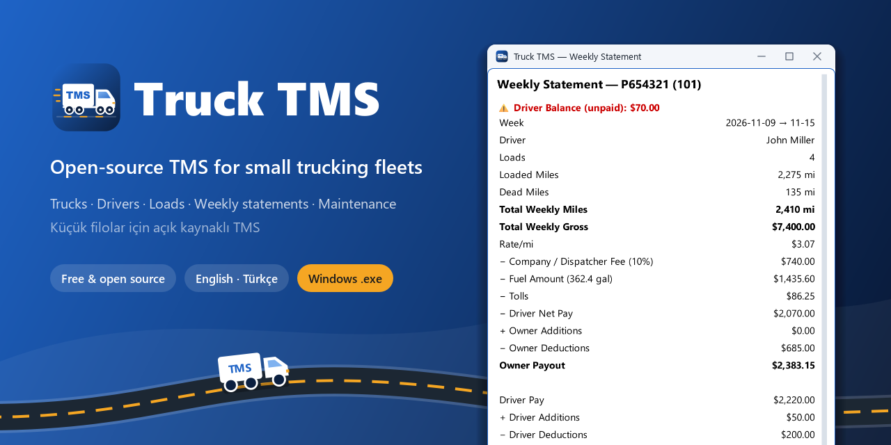
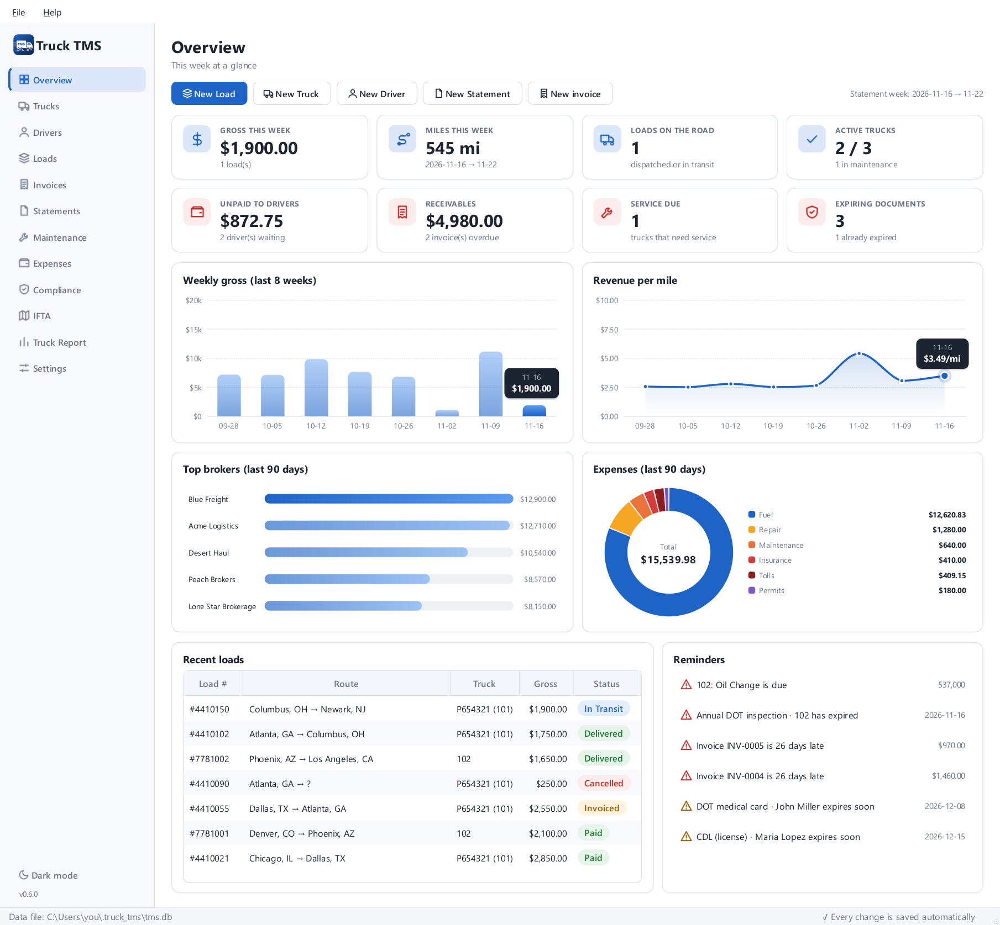
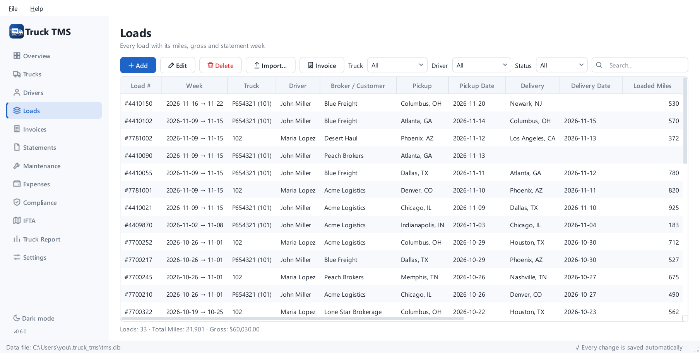
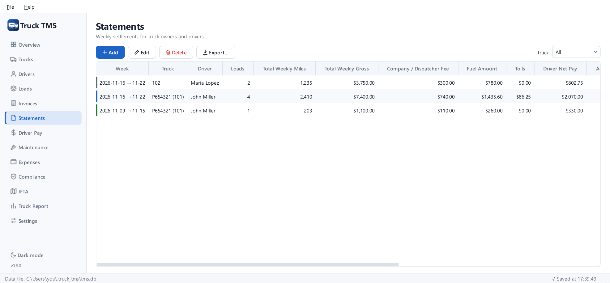
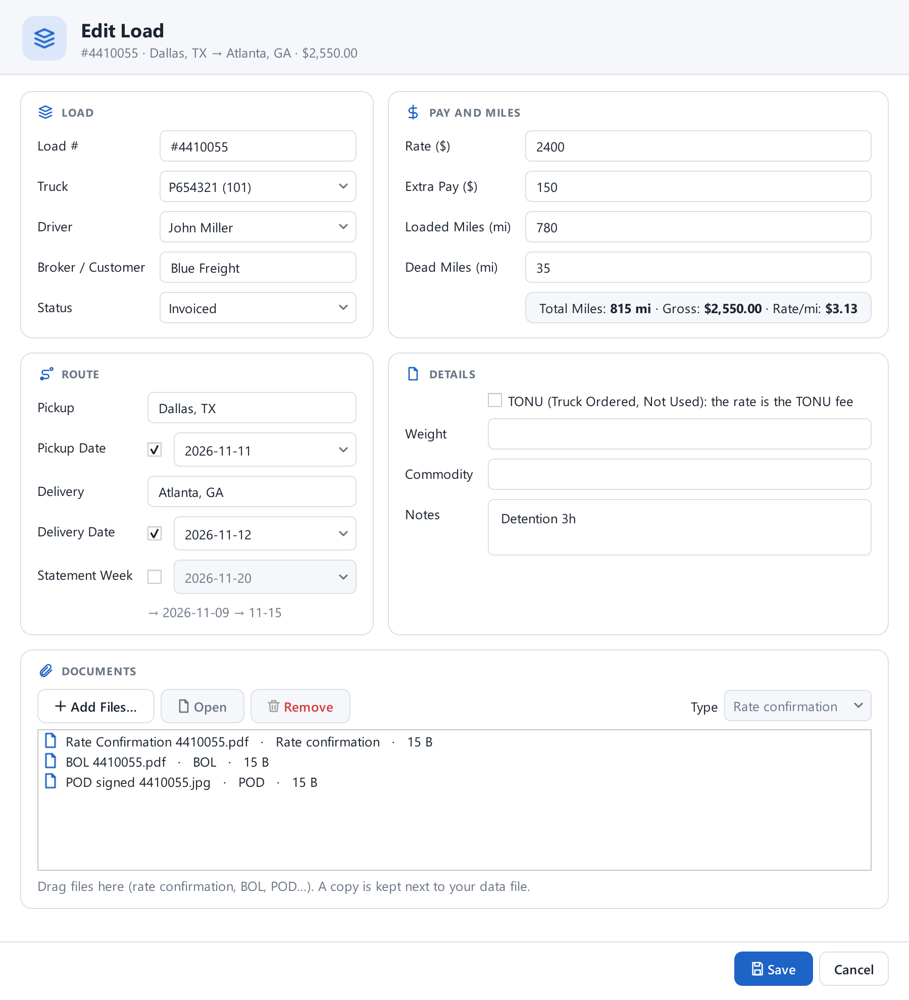
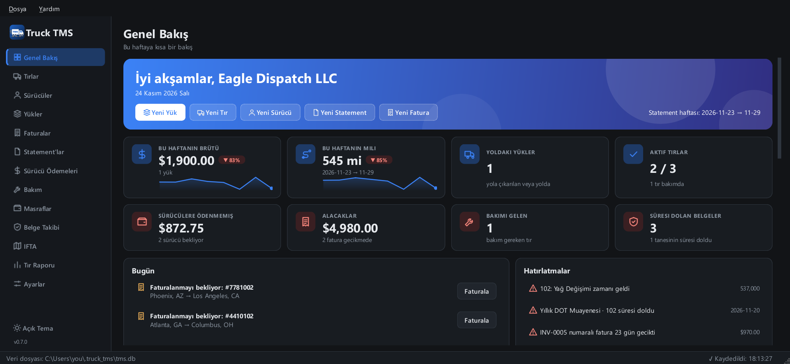
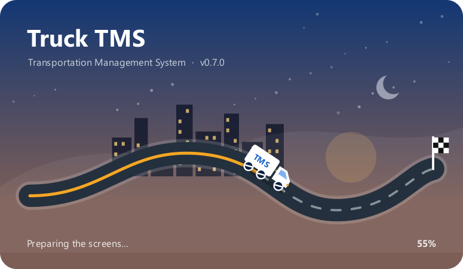

<p align="center">
  
</p>

<p align="center">
  <a href="https://github.com/ArslanEren-Dev/truck-tms/releases/latest"></a>
  <a href="https://github.com/ArslanEren-Dev/truck-tms/actions/workflows/tests.yml"></a>
</p>

<p align="center">
  
  
  
  
  
</p>

<p align="center">
  <b><a href="https://arslaneren-dev.github.io/truck-tms/">Website</a></b> ·
  <b><a href="https://github.com/ArslanEren-Dev/truck-tms/releases/latest">Download</a></b> ·
  <b><a href="#türkçe">Türkçe açıklama aşağıda</a></b>
</p>

**Truck TMS** is a free, open-source desktop app for small trucking fleets, dispatchers and owner-operators.
Trucks, drivers, loads, weekly statements and maintenance are all in one place, on your own computer: no account, no subscription, no cloud.
It is written in Python + Qt (PySide6), stores its data in a single SQLite file, and runs in English or Turkish with a white or black theme.



## Features

- **Trucks**: identify a truck by **plate, unit # or both**. Common US makes and models (Freightliner, Kenworth, Peterbilt,
  Volvo, Mack, International, Western Star…) are built in, and you can also type your own. Year, VIN, **odometer**, truck owner,
  default driver and company fee %. **Change a plate at any time**: loads stay linked to the truck and every change
  is kept in the **plate history**.
- **Drivers**: contact details, CDL # and expiry, and **pay settings**: % of gross, per mile/km, or a fixed weekly salary.
  The list shows each driver's **unpaid balance**.
- **Loads**: every detail is optional. **Load # always starts with `#`**. Each load can have a truck, a driver, broker,
  pickup and delivery, **rate**, **extra pay** (detention, layover, lumper), **loaded miles**, **dead miles**, and a **TONU** flag.
  The app calculates **total miles**, **gross per load** and **rate per mile**. The list shows which **statement week** each load
  belongs to.
- **Weekly statements** (one per truck per week):
  - Loads are picked up automatically for the week (cancelled loads are skipped unless TONU).
  - Totals: **total weekly miles** (loaded + dead) and **total weekly gross**.
  - Costs: **fuel amount**, **fuel gallons**, **tolls**, and the **company / dispatcher fee** (% and/or fixed).
  - **Driver salary**: calculated from the driver's pay settings, or entered by hand. Add **driver additions and deductions**
    (bonus, advance…).
  - **Driver payment tracking**: the amount actually paid and the **payment date**. The app shows the remaining balance,
    because what the statement says is not always what gets paid.
  - **Owner additions and deductions** (insurance, trailer rental, ELD…) and the final **owner payout**.
  - **Export** an owner statement PDF, a driver statement PDF, a CSV, or all three. You can export this statement
    or every statement of the week, and **choose the folder and the file name**. The app remembers the folder.
- **Maintenance**: service records with odometer, cost, shop, details, and the next due date or odometer.
  Trucks that are due for service are highlighted.
- **Expenses** and a **Truck report** for any date range: gross, miles, expenses + maintenance, and net. Export it as PDF/CSV or print it.
- **Your data is always saved**:
  - Every change is written to the data file immediately. The status bar shows the file and the last save time.
  - **File** menu: *New data file*, *Open data file*, *Save* (Ctrl+S), *Save a backup copy*, *Open data folder*.
  - **Automatic daily backups** of the last 14 days are kept in a `backups` folder next to the data file.
  - The app reopens the file you used last.
- **Overview**: this week's gross and miles, loads on the road, active trucks, unpaid driver pay and trucks due for
  service. The numbers count up when the page opens.
  - **Charts**: weekly gross for the last 8 weeks, revenue per mile, and top brokers of the last 90 days.
    They animate in and show values on hover.
  - Recent loads, reminders (service due, CDL expiring), and quick buttons for a new load, truck, driver or statement.
- **Import from Excel or CSV**:
  - Bring your existing loads in from a spreadsheet (`.xlsx` or `.csv`).
  - Columns are matched automatically from English or Turkish headers ("Load #", "PU Date", "DH", "Navlun"…).
    A preview lets you check the matching first.
  - US and Turkish number and date formats both work, as do Excel dates.
  - Trucks and drivers that do not exist yet are created for you, and loads that are already in the app are skipped.
  - A ready-made template is one click away.
- **Load documents**:
  - Drag rate confirmations, BOLs, PODs, invoices and receipts onto a load. The type is guessed from the file name.
  - A copy is kept in a `<data file>_documents` folder, so the originals can be moved or deleted.
  - Statement exports can include the loads' documents, and *Save a backup copy* copies them too.
- **Look and feel**:
  - A sidebar whose highlight slides to the page you pick, and pages that glide in.
  - A clean **white** or **black** theme with a one-click switch.
  - Colored status badges (Active, In Transit, Paid…) and icon buttons that lift when you hover over them.
  - Small notifications ("Saved", "Deleted", "Exported") that slide in at the bottom right.
  - Friendly empty pages that tell you what to add first.
  - A start-up animation where a truck drives down the road while the app loads.
- **English and Turkish** throughout, including dialogs, date pickers and PDFs. Automated tests check that every
  text exists in both languages.
- **Settings**: language, theme, company name and address for documents, currency, miles or km,
  the weekday statement weeks start on, and the default company fee %.

| Weekly statement | Trucks |
|---|---|
|  |  |
| **Loads** | **Statements** |
|  |  |
| **Drivers** | **Maintenance** |
|  |  |
| **Import from Excel / CSV** | **Load documents** |
|  |  |
| **Dark theme · Türkçe** | **Start-up animation** |
|  |  |

### How the statement is calculated

```
Owner payout   = total weekly gross
               − company / dispatcher fee  (gross × % + fixed)
               − fuel − tolls
               − driver net pay            (only if "driver is paid out of this statement" is ticked)
               + owner additions − owner deductions

Driver net pay = driver salary (auto or manual) + driver additions − driver deductions
Driver balance = driver net pay − amount actually paid to the driver
```

A load belongs to the week of its delivery date (or its pickup date if there is no delivery date).
You can also choose the week by hand on the load.

## Download (Windows)

Download `TruckTMS.exe` from the [Releases](https://github.com/ArslanEren-Dev/truck-tms/releases) page and double-click it. You don't need to install Python.
Windows may show a SmartScreen warning because the exe is not code-signed. Click **More info → Run anyway**.
On Windows 11 with **Smart App Control** turned on, the exe may be blocked. In that case, run the app from source (see below).
Signed releases are planned through the SignPath Foundation; see the [code signing policy](docs/CODE_SIGNING.md).

To build the exe yourself, run `powershell -ExecutionPolicy Bypass -File build_exe.ps1`. The result is `dist\TruckTMS.exe`.

To try the app with sample data in a separate file, run `TruckTMS.exe --db demo.db --demo`.

## Install & run from source

Requires Python 3.11+.

```bash
git clone https://github.com/ArslanEren-Dev/truck-tms.git
cd truck-tms
python -m venv .venv
# Windows: .venv\Scripts\activate    macOS/Linux: source .venv/bin/activate
pip install -e .
truck-tms            # or: python -m truck_tms
```

Try it with sample data in a separate database:

```bash
truck-tms --db demo.db --demo
```

By default data is stored in `~/.truck_tms/tms.db`. You can change this with `--db PATH` or the `TRUCK_TMS_DB` environment variable.
To back up your data, copy that file. Databases created by older versions are upgraded automatically.

## Development

```bash
pip install -e ".[dev]"
pytest
```

```
truck_tms/
  database.py   SQLite schema, migrations, data classes and validation (no GUI code)
  statement.py  weekly statement calculation, HTML and CSV (no GUI code)
  report.py     truck report for a date range (no GUI code)
  importer.py   Excel/CSV import: .xlsx reader, column matching, row-by-row import (no GUI code)
  numbers.py    US / Turkish numbers and dates, Excel serial dates (no GUI code)
  weeks.py      statement-week helpers
  i18n.py       English / Turkish strings (add a language by adding a column)
  demo.py       sample data
  ui/           PySide6 windows, tabs, dialogs, theme, start-up animation
  assets/       app icon and theme images
tests/          pytest tests (database, statements, translations, backups and the GUI itself)
docs/           website (index.html), logo, banner, screenshots, make_media.py
build_exe.ps1   builds dist\TruckTMS.exe with PyInstaller
```

- `python docs/make_media.py` regenerates every screenshot and the banner from the demo data.
- `TruckTMS.exe --self-test FOLDER` checks a packaged build: it opens every screen in both languages and themes,
  exports PDFs and CSVs, and writes `self_test.log`.

### Publishing a new version

The exe is built by GitHub, so you don't have to build it on your own computer:

1. Set the new version in `truck_tms/__init__.py` and `pyproject.toml` (e.g. `0.6.0`).
2. On GitHub, open **Releases → Draft a new release**, create the tag `v0.6.0`, and click **Publish release**.
3. The [release workflow](.github/workflows/release.yml) runs the tests, builds `TruckTMS.exe`, runs the exe's self-test,
   and attaches `TruckTMS.exe` and its SHA-256 checksum to the release. This takes about 5 minutes; you can watch it on the **Actions** tab.

The workflow stops if the tag does not match the version in the code. Use **Actions → release → Run workflow** to build an exe without
publishing a release.

### Project website (GitHub Pages)

`docs/index.html` is a bilingual (EN/TR) landing page with the same truck-on-the-road animation as the app.
To publish it, open **Settings → Pages**, choose **Deploy from a branch**, then pick **main** and the **/docs** folder.
It will be online at <https://arslaneren-dev.github.io/truck-tms/>.

To set the social preview, open **Settings → General → Social preview** and upload `docs/banner.png` (1280×640).

Ideas for contributions: broker invoices and payment tracking, truck registration/insurance expiry reminders,
IFTA reports, fuel-card imports, and more languages. See the [contributing guide](.github/CONTRIBUTING.md);
issues and pull requests are welcome.

## License

[MIT](LICENSE) · [Third-party licenses](docs/THIRD_PARTY_LICENSES.md) · [Code signing policy](docs/CODE_SIGNING.md) ·
Made by [ArslanEren-Dev](https://github.com/ArslanEren-Dev)

Truck TMS adds no dependencies beyond Python and PySide6 (LGPL). It reads Excel files with the standard library
and draws its own charts, so the GPL-licensed Qt Charts module is not used.

---

## Türkçe

Küçük nakliye filoları, dispatch firmaları ve kendi tırıyla çalışanlar için ücretsiz, açık kaynaklı bir **TMS (Taşımacılık Yönetim Sistemi)**.
Tırlar, sürücüler, yükler, haftalık statement'lar ve bakım tek bir yerde, kendi bilgisayarınızda. Hesap, abonelik ya da bulut yok.
Python + Qt (PySide6) ile yazılmıştır. Veriler tek bir SQLite dosyasında tutulur. Arayüz Türkçe ve İngilizce, tema beyaz veya siyah olabilir.


### Özellikler

- **Tırlar**: tırı **plaka, araç kodu veya ikisiyle birden** kaydedin. ABD markaları ve modelleri listede hazır gelir
  (Freightliner, Kenworth, Peterbilt, Volvo, Mack, International, Western Star…), isterseniz kendiniz de yazabilirsiniz.
  Yıl, VIN, **kilometre/mil sayacı**, tır sahibi, varsayılan sürücü ve şirket kesintisi % de girilebilir.
  Plaka istendiği zaman değiştirilebilir ve her değişiklik **plaka geçmişinde** saklanır.
- **Sürücüler**: iletişim bilgileri, CDL no ve bitiş tarihi, **ödeme şekli** (brütün %'si, mil/km başına veya sabit haftalık).
  Listede her sürücünün **ödenmemiş bakiyesi** görünür.
- **Yükler**: tüm detaylar isteğe bağlıdır. **Load # her zaman `#` ile başlar.** Bir yükte tır, **yükü süren sürücü**,
  broker, **rate**, **ek ücret** (detention, layover, lumper), **yüklü mil**, **boş mil (dead mile)** ve **TONU** bilgisi bulunabilir.
  **Toplam mil**, **yük başına brüt (gross)** ve **mil başına rate** otomatik hesaplanır. Listede her yükün
  **hangi statement haftasına dahil olduğu** görünür.
- **Haftalık statement** (her tır için haftada bir tane):
  - O haftanın yükleri otomatik gelir.
  - Toplamlar: **haftalık toplam mil** ve **haftalık toplam brüt**.
  - Masraflar: **yakıt tutarı**, **yakıt (galon)**, **toll** ve **şirket/dispatcher kesintisi** (% ve/veya sabit).
  - **Sürücü maaşı**: sürücünün ödeme ayarlarından otomatik hesaplanır ya da elle girilir. **Sürücüye eklenenler ve
    sürücü kesintileri** (bonus, avans…) ayrı satırlarda yazılır.
  - **Sürücü ödeme takibi**: sürücüye **gerçekte ödenen tutar** ve **ödeme tarihi** girilir, kalan bakiye gösterilir.
    Statement'ta yazan her zaman ödenmeyebilir.
  - **Tır sahibi kesintileri ve eklemeleri** (sigorta, trailer kirası, ELD…) ve sonuçta **tır sahibine ödenecek tutar (owner payout)**.
  - **Dışa aktarma**: tır sahibi PDF'i, sürücü PDF'i, CSV veya üçü birden. Yalnızca bu statement ya da o haftanın
    bütün statement'ları seçilebilir. **Klasör ve dosya adı sizin seçiminizdir**; seçilen klasör hatırlanır.
- **Bakım**: sayaç, tutar, servis, detaylar, sonraki bakım tarihi veya sayacı. Bakımı gelen tırlar kırmızı ile işaretlenir.
- **Masraflar** ve tarih aralığına göre **tır raporu** (PDF/CSV olarak dışa aktarma veya yazdırma).
- **Verileriniz her zaman kayıtlı**:
  - Her değişiklik anında veri dosyasına yazılır. Alttaki durum çubuğunda dosyanın yeri ve son kayıt saati görünür.
  - **Dosya** menüsü: *Yeni veri dosyası*, *Veri dosyası aç*, *Kaydet* (Ctrl+S), *Yedek kopya kaydet*, *Veri klasörünü aç*.
  - Veri dosyasının yanındaki `backups` klasöründe **son 14 günün otomatik yedeği** tutulur.
  - Uygulama en son kullandığınız dosyayı açar.
- **Genel Bakış**: bu haftanın brütü ve mili, yoldaki yükler, aktif tırlar, sürücülere ödenmemiş tutar ve bakımı gelen
  tırlar. Sayfa açılınca sayılar animasyonla artar.
  - **Grafikler**: son 8 haftanın brütü, mil başına gelir ve son 90 günün en iyi broker'ları. Animasyonla gelirler ve
    fareyle üzerine gelince değerleri gösterirler.
  - Son yükler, hatırlatmalar (bakım zamanı, ehliyet süresi) ve yeni yük, tır, sürücü ya da statement için hızlı butonlar.
- **Excel veya CSV'den aktarma**:
  - Mevcut yüklerinizi bir tablodan (`.xlsx` veya `.csv`) içeri alın.
  - Sütunlar Türkçe ya da İngilizce başlıklarına göre otomatik eşleştirilir ("Yük No", "Navlun", "PU Date", "DH"…);
    önizlemede kontrol edebilirsiniz.
  - ABD ve Türkiye sayı/tarih biçimleri de Excel tarihleri de doğru okunur.
  - Kayıtlı olmayan tır ve sürücüler oluşturulur, zaten kayıtlı yükler atlanır.
  - Hazır şablon tek tıkla indirilir.
- **Yük belgeleri**:
  - Rate confirmation, BOL, POD, fatura ve fişleri bir yükün üzerine sürükleyin; türü dosya adından tahmin edilir.
  - Bir kopyası `<veri dosyası>_documents` klasöründe saklanır, böylece asıl dosyayı taşıyabilir ya da silebilirsiniz.
  - Statement dışa aktarılırken belgeler de eklenebilir; *Yedek kopya kaydet* belgeleri de yedekler.
- **Görünüm**:
  - Seçtiğiniz sayfaya kayarak giden vurgusuyla kenar menüsü ve yumuşakça kayarak açılan sayfalar.
  - Tek tıkla değişen temiz **beyaz** veya **siyah** tema.
  - Renkli durum rozetleri (Aktif, Yolda, Ödendi…) ve üzerine gelince yükselen ikonlu butonlar.
  - Sağ altta kayarak beliren küçük bildirimler ("Kaydedildi", "Silindi", "Dışa aktarıldı").
  - Liste boşken ilk ne ekleyeceğinizi söyleyen sayfalar.
  - Uygulama yüklenirken yolda ilerleyen bir tır animasyonu; tır yolun sonuna vardığında yükleme biter.
- Uygulamanın tamamı **Türkçe ve İngilizce**: pencereler, tarih seçiciler ve PDF'ler dahil. Otomatik testler her metnin
  iki dilde de bulunduğunu kontrol eder.
- **Ayarlar**: dil, tema, firma bilgileri, para birimi, mil/km, statement haftasının başladığı gün ve varsayılan şirket kesintisi.

### İndir (Windows)

[Releases](https://github.com/ArslanEren-Dev/truck-tms/releases) sayfasından `TruckTMS.exe` dosyasını indirip çift tıklayın. Python kurmanız gerekmez.
Exe imzalı olmadığı için Windows "Bilgisayarınız korundu" uyarısı gösterebilir. **Ek bilgi → Yine de çalıştır** deyin.
Windows 11'de **Akıllı Uygulama Denetimi** açıksa exe engellenebilir. Bu durumda uygulamayı aşağıdaki gibi kaynak koddan çalıştırın.
SignPath Foundation üzerinden imzalı sürümler planlanıyor; ayrıntılar [kod imzalama politikasında](docs/CODE_SIGNING.md).

Exe'yi kendiniz derlemek için `powershell -ExecutionPolicy Bypass -File build_exe.ps1` komutunu çalıştırın. Sonuç: `dist\TruckTMS.exe`.

### Kaynak koddan kurulum

Python 3.11 veya üzeri gerekir.

```bash
git clone https://github.com/ArslanEren-Dev/truck-tms.git
cd truck-tms
python -m venv .venv
# Windows: .venv\Scripts\activate    macOS/Linux: source .venv/bin/activate
pip install -e .
truck-tms            # veya: python -m truck_tms
```

Örnek verilerle denemek için: `truck-tms --db demo.db --demo`

Veriler ilk açılışta `~/.truck_tms/tms.db` dosyasında tutulur. Daha sonra uygulama, en son kullandığınız dosyayı açar.
Başka bir dosya kullanmak için **Dosya → Yeni / Aç** menüsünü, `--db` parametresini veya `TRUCK_TMS_DB` ortam değişkenini kullanabilirsiniz.
Yedekler `backups` klasöründe otomatik olarak tutulur; **Dosya → Yedek kopya kaydet** ile istediğiniz yere de yedek alabilirsiniz.
Eski sürümle oluşturulmuş veri dosyaları otomatik olarak güncellenir.

### Yeni sürüm yayınlama

Exe'yi GitHub derler, kendi bilgisayarınızda derlemeniz gerekmez:

1. `truck_tms/__init__.py` ve `pyproject.toml` dosyalarında sürüm numarasını güncelleyin (örneğin `0.6.0`).
2. GitHub'da **Releases → Draft a new release** deyin, `v0.6.0` etiketini oluşturun ve **Publish release** deyin.
3. [Release akışı](.github/workflows/release.yml) testleri çalıştırır, `TruckTMS.exe`'yi derler, exe'nin öz testini yapar ve exe ile
   SHA-256 özetini release'e ekler. Yaklaşık 5 dakika sürer; ilerlemeyi **Actions** sekmesinden izleyebilirsiniz.

Etiket koddaki sürümle eşleşmezse akış durur. Release yayınlamadan exe derlemek için: **Actions → release → Run workflow**.

### Tanıtım sitesi (GitHub Pages)

`docs/index.html`, uygulamadaki tır animasyonunu da içeren iki dilli (TR/EN) bir tanıtım sayfasıdır. Yayınlamak için:
**Settings → Pages → Deploy from a branch → main → /docs → Save**. Site birkaç dakika içinde
<https://arslaneren-dev.github.io/truck-tms/> adresinde açılır.

Paylaşımlarda görünen kapak görselini ayarlamak için: **Settings → General → Social preview → Edit → Upload an image** ve `docs/banner.png` dosyasını seçin.

### Katkı

Hata bildirimleri ve pull request'ler memnuniyetle karşılanır. Testleri çalıştırmak için: `pip install -e ".[dev]"` ve `pytest`.
Ekran görüntülerini ve banner'ı yeniden üretmek için: `python docs/make_media.py`.

Katkı rehberi: [.github/CONTRIBUTING.md](.github/CONTRIBUTING.md)

Lisans: [MIT](LICENSE) · [Üçüncü taraf lisansları](docs/THIRD_PARTY_LICENSES.md) · [Kod imzalama politikası](docs/CODE_SIGNING.md) ·
Geliştirici: [ArslanEren-Dev](https://github.com/ArslanEren-Dev)

Truck TMS, Python ve PySide6 (LGPL) dışında hiçbir ek paket kullanmaz: Excel dosyalarını Python'un kendi kütüphanesiyle okur,
grafikleri kendisi çizer (GPL lisanslı Qt Charts kullanılmaz).
